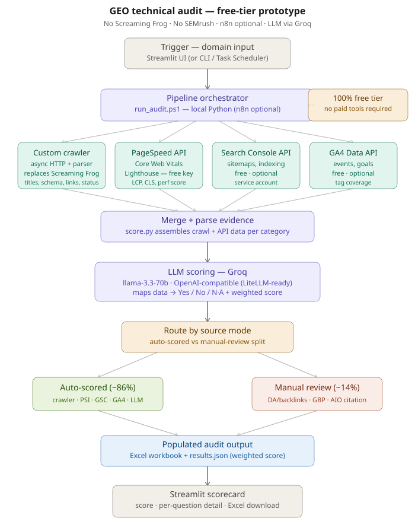
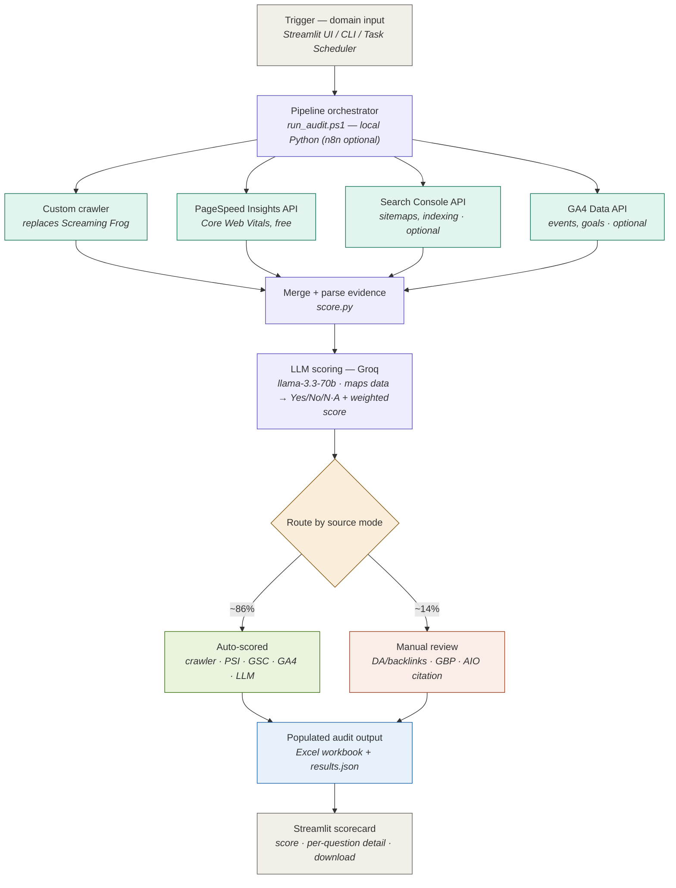

# Architecture

This pipeline mirrors the original GEO-audit flow, re-built on **100% free
tiers** — Screaming Frog and the SEMrush API are removed, n8n is optional, and
the LLM runs on Groq's free tier. SEO analysts drive it from a web UI.

## Flow (renders on GitHub)

## What changed vs the original n8n flow

| Original (n8n diagram) | This prototype | Why |
|---|---|---|
| n8n schedule / webhook trigger | **Streamlit UI** (or CLI / Task Scheduler) | Analyst-friendly, no n8n account |
| n8n orchestrator (Execute Command) | **`run_audit.ps1` — local Python** | No Docker/Execute Command needed once Screaming Frog is gone |
| Screaming Frog CLI (Docker sidecar) | **Custom crawler** (`crawler/crawl.py`) | Paid licence removed; free async crawler |
| SEMrush API | **dropped** → manual-review branch | No free tier |
| GSC / GA4 APIs | **unchanged** (free) | Still free |
| — | **PageSpeed Insights API** (new) | Free Core Web Vitals — wasn't in the original |
| n8n Merge + Code node | **`score.py` evidence assembly** | Same role, in code |
| LiteLLM → Gemini | **Groq `llama-3.3-70b`** (OpenAI-compatible, LiteLLM-ready) | Gemini free tier blocked on Workspace accounts |
| n8n IF node router | **`mode` tag** in the question bank | Auto vs manual split, deterministic |
| Excel template output | **Excel + `results.json`** | Adds machine-readable output for the UI |

## Auto vs manual split

Auto-scored ≈ **86%** of weight; manual ≈ **14%**. The manual residue is exactly
the off-page / competitive / local checks that only paid tools (SEMrush/Moz) or
human judgement can answer: domain authority & backlinks, Google Business Profile
/ local listings, and AI-Overview citation testing.
